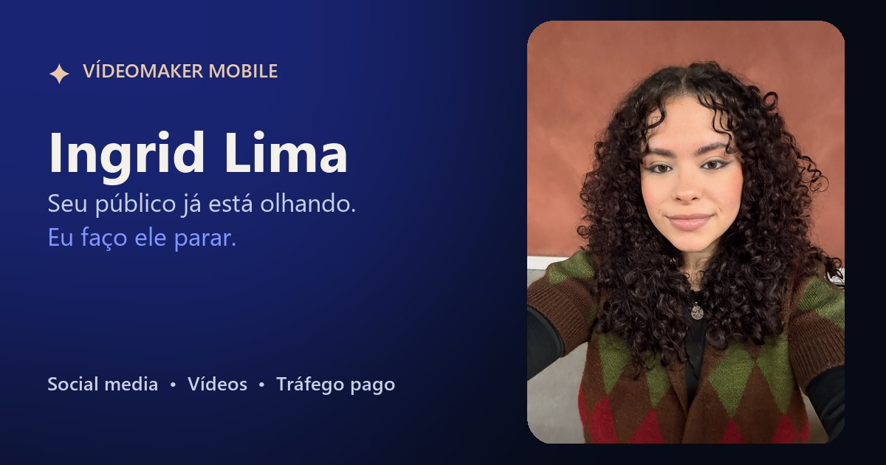

# Ingrid Lima · Vídeomaker Mobile ✦

> *"O feed não para. Seu público, sim."*

Landing page da **Ingrid Lima**, vídeomaker mobile, social media e gestora de tráfego pago ([@ingridlimadomkt](https://www.instagram.com/ingridlimadomkt/)).

[](https://carlosserra-a11y.github.io/ingrid-market/)


**🔗 Acesse:** https://carlosserra-a11y.github.io/ingrid-market/



---

## Sumário

- [Sobre o projeto](#sobre-o-projeto)
- [Destaques](#destaques)
- [Tecnologias](#tecnologias)
- [Seções da página](#seções-da-página)
- [Estrutura de pastas](#estrutura-de-pastas)
- [Como rodar localmente](#como-rodar-localmente)
- [Publicação](#publicação)
- [Como editar](#como-editar)
- [Desempenho](#desempenho)
- [Acessibilidade](#acessibilidade)
- [SEO e compartilhamento](#seo-e-compartilhamento)
- [Pendências](#pendências)
- [Autor e licença](#autor-e-licença)

---

## Sobre o projeto

Site de página única, estático e sem etapa de build, feito para apresentar o trabalho da Ingrid e transformar visitantes em contatos no WhatsApp.

O destaque é o **hero**: um olho castanho extremamente realista, com maquiagem em cobre rosé e delineado estilo Cleópatra, desenhado inteiramente por código em WebGL, ocupa o fundo da página. Ele segue o mouse (ou o dedo), pisca, reage ao clique e até fica com sono. Conforme a pessoa rola, a câmera mergulha na íris até entrar na pupila, onde a escuridão vira o visor de uma câmera gravando. A narrativa visual conecta o olhar da Ingrid ao feed do cliente.

## Destaques

- 👁️ **Olho realista em WebGL**: nenhuma imagem, só shader, nítido em qualquer tela e em qualquer zoom. Íris com fibras finas e relevo, pele iluminada em 3D com poros, delineado Cleópatra em gel, sombra cobre rosé metálica e mais de 200 cílios desenhados fio a fio.
- ✨ **Interativo**: segue o mouse e o dedo, pisca sozinho, arregala ou dá uma piscadinha no clique, semicerra com o mouse rápido, olha em volta quando ninguém mexe e cochila depois de um tempo. O painel **"✦ Brinque com o olhar"** troca a cor da íris e da sombra e liga/desliga a maquiagem.
- 🎬 **Mergulho guiado pela rolagem**, com três momentos de texto e um visor de câmera (REC, cronômetro e foco) dentro da pupila.
- 📱 **Portfólio em vídeo vertical**: 9 vídeos que tocam sem som ao aparecer na tela, com player em tela cheia para assistir com som.
- 💬 **Formulário que vira mensagem no WhatsApp**, com validação e envio opcional para planilha ou CRM.
- ⚡ **Leve onde importa**: vídeos carregam sob demanda, o canvas ajusta a resolução ao aparelho e tudo pausa quando sai da tela.
- ♿ **Acessível**: HTML semântico, navegação por teclado, contraste AA e respeito a `prefers-reduced-motion`.

## Tecnologias

| Camada | Ferramenta |
| --- | --- |
| Estrutura | HTML5 semântico |
| Estilo | CSS3 puro (variáveis, `clamp()`, unidades `svh`) |
| Interação | JavaScript puro (sem framework) |
| Gráficos | WebGL (shaders GLSL próprios) |
| Animações | [GSAP 3.13.0](https://gsap.com/) + ScrollTrigger 3.13.0 |
| Rolagem suave | [Lenis 1.3.4](https://lenis.darkroom.engineering/) |
| Fontes | Syne (títulos), Instrument Serif itálico (destaques) e Manrope (texto), via Google Fonts |
| Hospedagem | GitHub Pages |

As bibliotecas vêm de CDN (jsDelivr) com **versão fixa e Subresource Integrity** (`integrity="sha384-…"`), então o navegador recusa qualquer arquivo alterado.

## Seções da página

| Seção | Âncora | Conteúdo |
| --- | --- | --- |
| Hero | `#topo` | Olho em WebGL e o mergulho na pupila |
| Manifesto | `#manifesto` | Texto de posicionamento |
| Serviços | `#servicos` | Vídeos mobile, social media, tráfego pago, captação e edição |
| Marcas | — | Faixa com as marcas atendidas |
| Trabalhos | `#trabalhos` | Portfólio com os 9 vídeos |
| Processo | `#processo` | Etapas, do roteiro ao anúncio |
| Entregas | — | O que o cliente recebe, pronto para postar |
| Sobre | `#sobre` | Apresentação da Ingrid |
| Depoimentos | `#depoimentos` | Fica oculta enquanto não houver depoimentos |
| FAQ | `#faq` | Perguntas frequentes |
| Contato | `#contato` | Formulário que abre o WhatsApp |

## Estrutura de pastas

```
ingrid-market/
├── index.html           conteúdo e SEO (title, Open Graph, JSON-LD)
├── style.css            identidade visual, layout e responsivo
├── main.js              olho em WebGL, animações, vídeos e formulário
├── favicon.svg
├── apple-touch-icon.png
└── assets/
    ├── img/             fotos da Ingrid (WebP + JPG), og.jpg
    │   └── posters/     primeiro quadro de cada vídeo (WebP)
    └── videos/          portfólio: .mp4 (H.264) + .webm (VP9) de reserva
```

## Como rodar localmente

Não há dependências para instalar. Basta um servidor estático:

```bash
npx serve@14.2.4 -l 5173
```

Depois abra `http://localhost:5173`.

> **Atenção:** não abra o `index.html` direto do disco (`file://`). Os vídeos e o WebGL precisam de um servidor.

## Publicação

O site é publicado no **GitHub Pages** e atualiza sozinho a cada push na branch `main`.

Por ser estático, também funciona em Vercel, Netlify, Hostinger ou qualquer hospedagem de arquivos: basta apontar para a raiz do repositório.

Se mudar de domínio, atualize `og:url` e `og:image` no `index.html` com o novo endereço, para a prévia aparecer certinho no WhatsApp e no Instagram.

## Como editar

### WhatsApp, mensagem e formulário

No topo do `main.js`, no objeto `CONFIG`:

| Campo | O que faz |
| --- | --- |
| `whatsapp` | Número com DDI e DDD, só dígitos (ex.: `5548996966456`) |
| `waMessage` | Mensagem pré-preenchida dos botões |
| `formEndpoint` | Opcional. URL que recebe os dados do formulário em JSON (Formspree, Make, Zapier, Google Apps Script…). Vazio = só abre o WhatsApp com a mensagem montada |

Os links no HTML já apontam para o número, para funcionar mesmo sem JavaScript. O `main.js` reescreve todos os elementos `[data-wa]` a partir do `CONFIG`.

### Textos

Todos estão no `index.html`, organizados por seção e marcados com comentários `<!-- ===== -->`.

### Cores e fontes

Variáveis no topo do `style.css` (`:root`):

| Variável | Cor | Uso |
| --- | --- | --- |
| `--bg` | `#070b16` | Fundo |
| `--primary` | `#4f6bff` | Botões e destaques |
| `--accent` | `#e9c9a9` | Detalhes, foco e links |
| `--rose` | `#f2b8c6` | Toques de cor |

### Vídeos do portfólio

1. Exporte em vertical, 720×1280. Para converter um `.MOV` do iPhone:

   ```bash
   # MP4 (H.264) — formato principal
   ffmpeg -i entrada.MOV -vf "scale=720:1280,fps=30,format=yuv420p" -c:v libx264 -preset slow -crf 27 -movflags +faststart -c:a aac -b:a 96k assets/videos/nome.mp4

   # WebM (VP9) — reserva
   ffmpeg -i assets/videos/nome.mp4 -c:v libvpx-vp9 -b:v 0 -crf 45 -c:a libopus -b:a 64k assets/videos/nome.webm

   # Poster (primeiro quadro exibido antes do play)
   ffmpeg -ss 2 -i assets/videos/nome.mp4 -frames:v 1 -c:v libwebp -quality 72 assets/img/posters/nome.webp
   ```

   Vídeos em HDR (iPhone) precisam de *tone mapping*. Veja o filtro `zscale…tonemap` usado no vídeo do Omoda 7.

2. No `index.html`, copie um bloco `<li class="reel">` e troque os caminhos, o título, o cliente e o `data-reel` (índice sequencial, começando em `0`).

Os arquivos originais (`.MOV`, `.HEIC`) estão no `.gitignore`: exporte para `assets/` antes de versionar.

### Depoimentos

Em `main.js`, preencha a lista `TESTIMONIALS` com depoimentos **reais**. Enquanto ela estiver vazia, a seção fica oculta.

### O olho do hero

O olho é um shader WebGL (`EYE_FRAG` no `main.js`). Os principais pontos de ajuste:

| O que mudar | Onde |
| --- | --- |
| Cores da íris e da sombra, maquiagem inicial | Objeto `EYE_STYLE`, no começo da seção do olho no `main.js`. O painel ✦ é montado a partir dele |
| Esconder o painel "✦ Brinque com o olhar" | `EYE_STYLE.kit = false` |
| Tom da pele, delineado, cílios, sobrancelha e esclera | Constantes `SKIN`, `SKIN_DEEP`, `LASHLINE`, `LINER`, `BROW` e `SCLERA`, no topo do `EYE_FRAG`. A cor dos cílios está em `lashColor()` |
| Direção da luz | `LK` (luz principal, do alto à esquerda), `LF` (rebatedor) e `HV` (brilho), no topo do `EYE_FRAG` |
| Ponta do gatinho | `WING` (posição) e `thUp()` (espessura do traço de cima) |
| Tamanho da íris e quanto ela anda | `IRIS_R` e `LOOK` |
| Posição e tamanho | Método `layout()` da classe `Eye` |
| Ritmo do mergulho | Função `heroScroll()`. O zoom usa o tamanho da íris na tela (`zoomFor`), então funciona igual no celular e no desktop |
| Duração do mergulho | `.hero { height: 300svh }` no `style.css` (`220svh` no celular) |
| Palavra que se alterna no título | `.cycle` no `index.html` e `heroCycle()` no `main.js` |

<details>
<summary><strong>Todos os detalhes do olho</strong></summary>

- **Estilo realista:** luz, textura e profundidade de fotografia macro, mantendo o formato do olho e o delineado gráfico. Tudo é calculado por pixel, então continua nítido em tela retina e no zoom do mergulho.
- **Íris** (`iris()` e `fibers()`): três escalas de fibras radiais finas (largas, médias e fios) com relevo iluminado pela luz principal, claras sobre vãos mais escuros; colarete irregular em zigue-zague com crista clara e sombra, zona da pupila mais clara e quente, criptas de Fuchs em forma de lente com borda clara, sulcos de contração na periferia, sardinhas de pigmento, anel limbal esfumado e franja escura em volta da pupila. A íris é côncava e recebe a sombra da pálpebra e a cáustica da córnea (luz concentrada no lado oposto à fonte). Fios cada vez mais finos aparecem conforme a câmera se aproxima.
- **Córnea e reflexos:** o reflexo de um ring light (de quem grava), uma janela suave e um pontinho de rebote, que ficam do lado da luz e não giram com o olho. No mergulho, a córnea sai de foco e o reflexo fica macio.
- **Delineado Cleópatra** (`liner()`): fino no canto interno, grosso no externo e com um gatinho longo e afiado; embaixo, uma linha que sai do canto paralela ao gatinho, sem fechar com ele; e uma ponta no canto interno apontando para o nariz. Tudo preso às pálpebras: ao piscar, o traço desce junto e a ponta do gatinho fica parada.
- **Delineado de verdade** (`liner()`): gel preto com borda de cima levemente irregular, penumbra de pigmento, espessura que afina na ponta do gatinho (onde deixa a pele aparecer) e um fio de brilho molhado; kohl na linha d'água (mais forte no canto externo), linha de baixo com borda de lápis e esfumado marrom leve em volta. As pálpebras se encontram no canto externo, sem degrau.
- **Maquiagem** (`skin()`): sombra metálica na pálpebra móvel com brilho no centro (padrão "Cobre rosé"), tom de vinho no vinco e no canto externo em "V" (derivado da cor escolhida no painel ✦), esfumado pêssego subindo até a sobrancelha, champagne no canto interno e linha de baixo esfumada em bronze. Ao fechar o olho, a pálpebra estica e leva a sombra junto.
- **Cílios** (`upLayer()`, `lowLayer()`, `strand()` e `lashPaint()`): três fileiras em cima (40 compridos, 64 médios e 110 finos) e 46 curtinhos embaixo, cada um com comprimento, ângulo, curvatura e espessura próprios; vizinhos se juntam em tufos e o comprimento cresce para o canto externo. Cada fio é uma curva que afina até a ponta, com raiz escura, ponta marrom e um fio de brilho do lado da luz, e projeta uma sombra suave na pele e no globo. Fios mais finos que um pixel ficam transparentes em vez de serrilhar. Ao piscar, os de cima giram com a pálpebra e apontam para baixo.
- **Pele com profundidade** (`skinH()` e `skin()`): relevo do osso da sobrancelha, da órbita, da pálpebra abaulada sobre o globo, do vinco e da olheira, iluminado em 3D com luz difusa macia, um toque de subsurface (o tom quente da pele translúcida), oclusão nas dobras e brilho úmido. De perto aparecem poros (`pores()`) e linhas finas.
- **Globo ocular** (`ball()`): esfera iluminada (o branco do olho nunca é branco chapado), vasinhos discretos nos cantos, carúncula úmida, linha d'água rosada com o menisco de lágrima brilhando, sombra larga da pálpebra e dos cílios e a dobra funda do canto externo.
- **Sobrancelha** (`brow()` e `browHairs()`): cheia e marcada, com cabeça grossa, arco definido e cauda que afina; base de pó escura que some devagar na cauda e três camadas de pelos finos, em dois ângulos cruzados, que sobem na cabeça, deitam no meio e descem na ponta. Com a maquiagem ligada fica mais escura e mais cheia.
- **Câmera:** o olho abre desfocado e a lente "puxa o foco", com um quadrado de autofoco na pupila. Clicar ou tocar no olho dispara o autofoco ali.
- **Vivo:** segue o mouse e o dedo a partir de onde o olho está na tela; pisca a cada 2 a 6 s (às vezes duas vezes), achatando um pouco no meio da piscada; a pupila dilata quando o ponteiro chega perto ou passa nos botões; semicerra quando o mouse passa rápido; sem ninguém mexer, olha em volta com saltos e pausas e, depois de uns 16 s, fica com sono e acorda assustado.
- **Clique ou toque:** alterna entre susto (aperta, arregala passando do ponto e volta balançando) e piscadinha.
- **Desfoque de movimento** acompanha a velocidade da rolagem: quando a pessoa para, a íris fica nítida.

**Roteiro do mergulho** (`.hero__story` e `.viewfinder` no `index.html`):

1. Nos olhos: *"Antes de qualquer câmera, existe um olhar."*
2. Na íris, onde a câmera desacelera: *"É nos detalhes que o público para."*
3. Dentro da pupila, que vira o visor de uma câmera gravando: *"Do meu olhar para o seu feed."*

</details>

## Desempenho

- **Vídeos sob demanda:** carregam só quando aparecem na tela (`preload="none"`), no máximo 2 tocam ao mesmo tempo e sempre sem som.
- **Economia de dados:** com o modo "economia de dados" do celular ativo, os vídeos não tocam sozinhos.
- **Canvas adaptativo:** o WebGL limita a densidade de pixels, reduz a resolução sozinho se o aparelho não acompanhar e pausa quando sai da tela ou a aba fica oculta.
- **Imagens responsivas** em WebP, com JPG de reserva.
- **Plano B:** sem WebGL, entra um olho feito em CSS (`.fb-eye`), no mesmo estilo (delineado com gatinho, íris em fibras e o reflexo do ring light), com o mesmo mergulho.

## Acessibilidade

- HTML semântico, com landmarks e títulos em ordem.
- Link "Pular para o conteúdo" e foco sempre visível.
- Menu e player navegáveis por teclado: `Esc` fecha e as setas `←` `→` trocam o vídeo.
- Formulário com mensagens de erro ligadas a cada campo (`aria-describedby`).
- Contraste AA.
- Com `prefers-reduced-motion`, o hero fica estático, sem zoom e sem rolagem suave. O painel ✦ continua funcionando, com as trocas instantâneas.
- Painel ✦ navegável por teclado: botões com `aria-pressed`, interruptor com `role="switch"` e `Esc` fecha.
- Testado em 375 px (celular), 961 px e 1440 px, sem rolagem horizontal e sem erros no console.

## SEO e compartilhamento

- `title` e `meta description` focados nos serviços e na região.
- **Open Graph** e **Twitter Card** com imagem de 1200×630 (`assets/img/og.jpg`) para a prévia no WhatsApp, Instagram e redes sociais.
- **Dados estruturados** (JSON-LD, schema.org): `Person` e `ProfessionalService`, com redes sociais, telefone e área atendida.

## Pendências

- [ ] **[CONFIRMAR]** Autorização para citar **Cloud Tech**, **Dimas Omoda Jaecoo** e **Dra. Elizabeth Mello** (faixa de marcas e legendas do portfólio).
- [ ] **[CONFIRMAR]** Nome do cliente do vídeo de gastronomia (*Mesa posta · bastidores*). Hoje a legenda diz "Chef em evento".
- [ ] **[CONFIRMAR]** Cidade e região de atendimento presencial. Hoje o texto diz "Santa Catarina" (Sobre e FAQ).
- [ ] **[CONFIRMAR]** Respostas do FAQ (prazo, tráfego pago, preço) no tom da Ingrid.
- [ ] **[PREENCHER]** Depoimentos reais em `TESTIMONIALS`.
- [ ] **[OPCIONAL]** `formEndpoint` para guardar os leads também numa planilha ou CRM.

## Autor e licença

Desenvolvido por **[carlosserra-a11y](https://github.com/carlosserra-a11y)**.

Este repositório não tem licença de código aberto: o código não pode ser reutilizado sem autorização. As fotos e os vídeos pertencem à Ingrid Lima e aos clientes citados.
